# Guest Complaint Root-Cause Intelligence

**Team TechNova | HackNow 2026 (ServiceNow and Accenture) | Problem HOT-04**

> A closed complaint is not a solved problem. We find the cause, so it is fixed once.

## The problem

Hotels fix every guest complaint one by one, but never find out why the same problem keeps coming back. For example, four different guests report "AC not working" in the same room. Staff fix each one and close the ticket, and the real cause stays open.

Who it hurts:
- **Guests** face the same issue again.
- **Staff** repeat the same repair.
- **Managers** see how many complaints there are, not why.

## Our solution

In short, this solution finds the real cause of repeated guest complaints for hotels, by grouping similar complaints into one Problem that is fixed once.

It is built in **ServiceNow Customer Service Management (CSM)** using standard features and simple configuration.

**Our difference: innovation.** The system finds repeats on its own and uses AI to group similar complaints, so the team works on the cause and not only the symptom.

## How it works

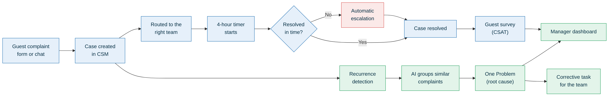

## Workflows

### 1. Escalation (SLA Escalation flow)

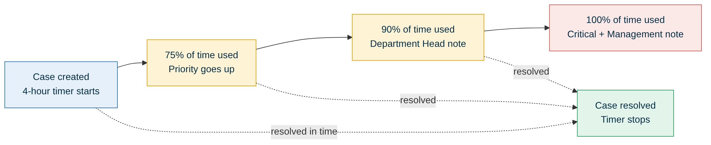

Each case gets a 4-hour "Complaint Resolution" SLA. If the case is not resolved, the flow raises the priority at 75%, notes the Department Head at 90%, and makes the case Critical with a Management note at 100%.

### 2. From repeat complaints to the root cause (Recurrence Detection and Create Corrective Action Task flows)

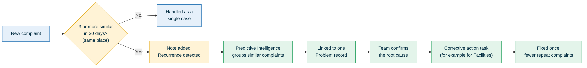

When 3 or more similar complaints come from the same place within 30 days, the case gets a "Recurrence detected" note. AI groups similar complaints, they are linked to one Problem record, and the team confirms the cause and creates a corrective task.

## What is built in the ServiceNow instance

| Area | What we built |
|---|---|
| Guest entry | Record Producer **"Raise a Complaint"** (problem, category, room, equipment, details) and a Virtual Agent chat topic |
| Hotel data | Property, floor, room and equipment structure linked to each case |
| Routing | 7 assignment rules, for example AC to Facilities, Cleanliness to Housekeeping, Noise to Front Desk |
| SLA | "Complaint Resolution" SLA of 4 hours |
| Escalation flow | At 75% priority goes up, at 90% a Department Head note, at 100% Critical and a Management note |
| Recurrence detection | Flow that adds "Recurrence detected" when 3 or more similar complaints come from the same place within 30 days |
| AI grouping | Predictive Intelligence Similarity and Clustering on complaint text |
| Root cause | Problem record (for example PRB0040002 with 4 linked cases) and a Create Corrective Action Task flow |
| Feedback | CSAT survey: a rating of 1 to 5 plus a comment |
| Dashboard | Platform Analytics dashboard "Guest Complaint Root-Cause Intelligence" |

## Demo

The demo shows one complaint from the first click to the result:

1. Guest raises a complaint (AC not working, Room 501).
2. Case is routed to Facilities and the 4-hour timer starts.
3. The case escalates by itself.
4. The repeat is detected.
5. One Problem is created with 4 linked cases.
6. The guest survey and the manager dashboard show the result.

Demo video: `<add link or file name, for example DEMO_serviceNOW.mp4>`

Where to find the pages in the instance: **Customer Service > Cases > All**, **Problem > All**, **Platform Analytics**.

## Screenshots

All screenshots are from our ServiceNow instance during the demo.

| Step | Screenshot |
|---|---|
| 1. Guest raises a complaint (Record Producer "Raise a Complaint") | 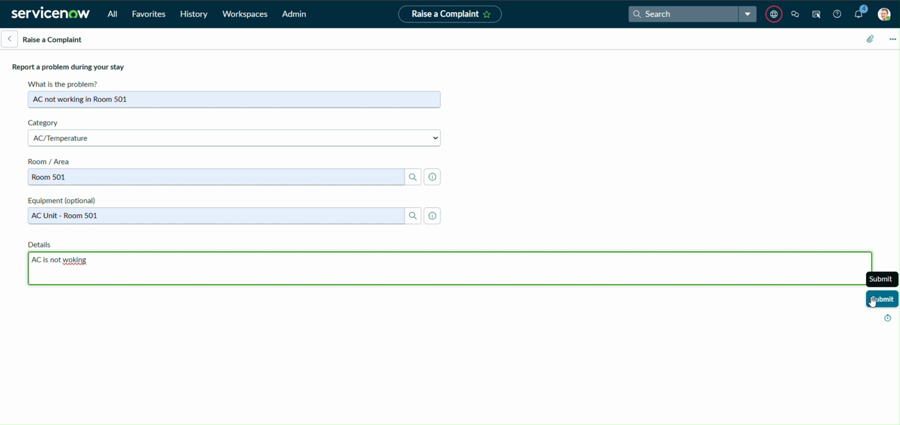 |
| 2. Case created and routed to Facilities (Case CS0001062) | 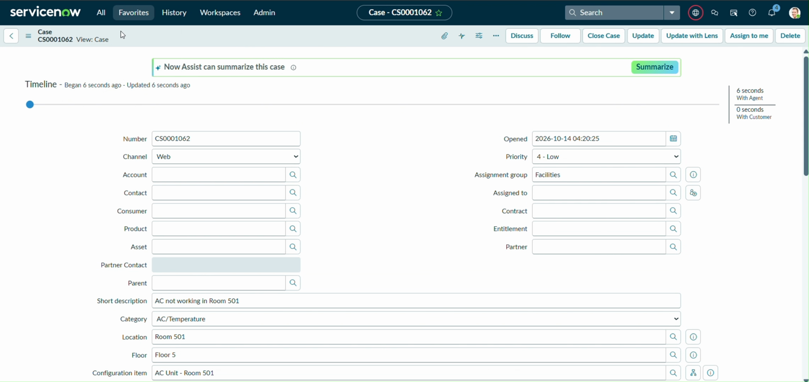 |
| 3. SLA definition "Complaint Resolution" | 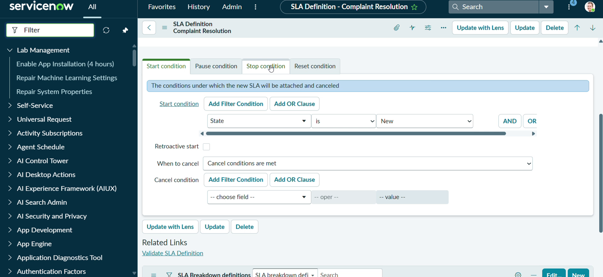 |
| 4. Automatic escalation shown in the case activities (Case CS0001055) | 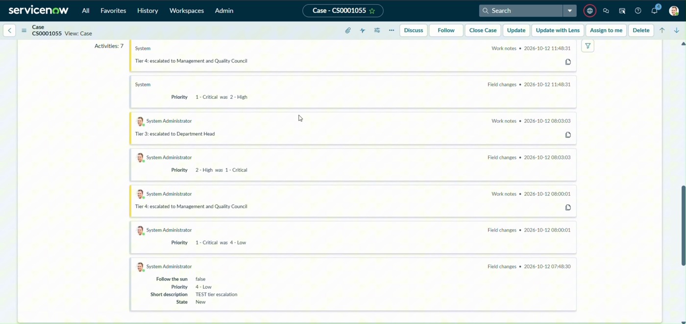 |
| 5. "Recurrence detected" note (Case CS0001056) | 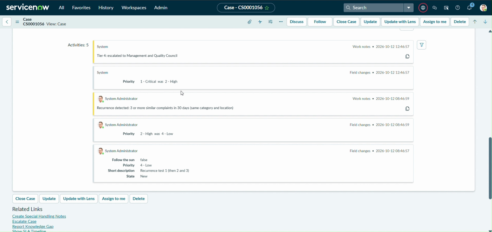 |
| 6. AI clustering of complaints (Predictive Intelligence) | 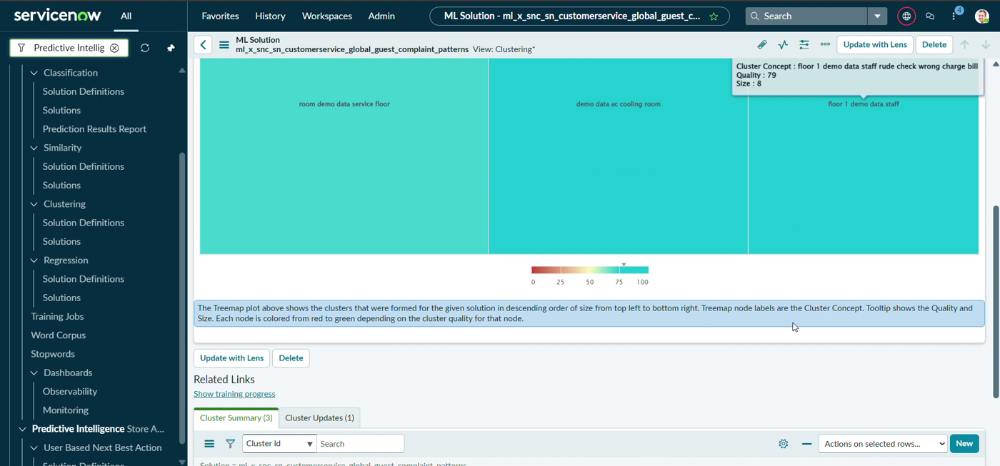 |
| 7. Four AC complaints linked to one Problem, PRB0040002 | 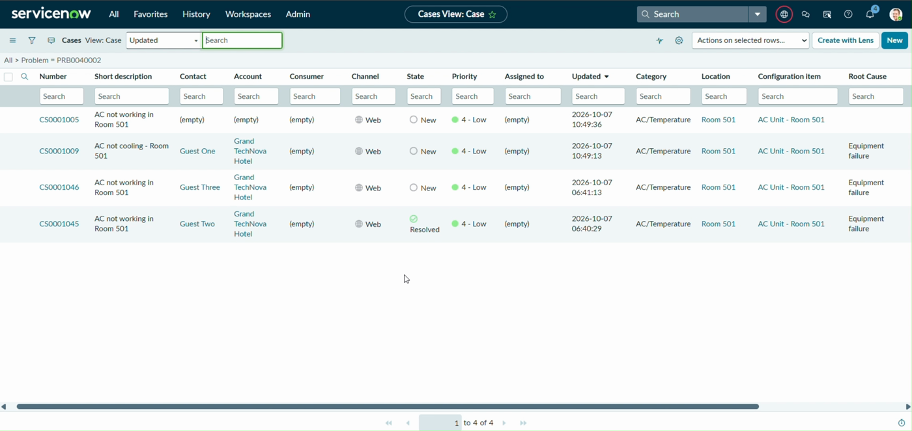 |
| 8. Guest survey response (CSAT) | 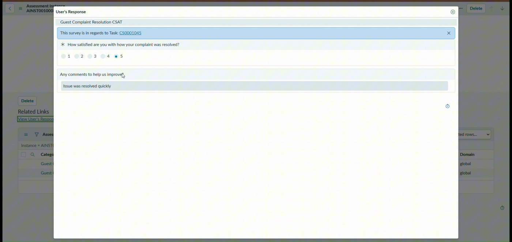 |
| 9. Manager dashboard in Platform Analytics | 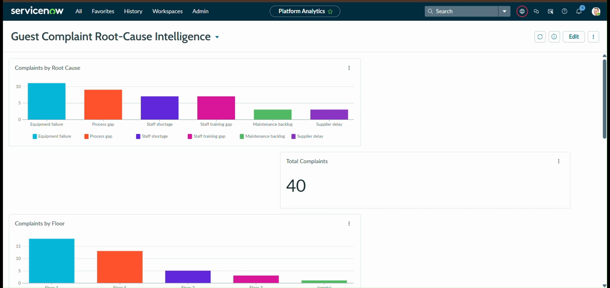 |

## Results (demo data)

These numbers come from our demo data, not from a live hotel.

- **4 complaints to 1 Problem:** 75% less repeat work.
- **27 complaints grouped into 3 clusters** by AI. One cluster is the Floor 5 AC problem.
- **40 complaints** on the manager dashboard. Equipment failure is the top cause, and AC units lead the equipment chart.

## Honest scope

- The AI **groups** similar complaints. The team **confirms** the real cause on the Problem record.
- The dashboard is built with Platform Analytics.
- **Planned, not built yet:** QR code in every room, Integration Hub links to booking, housekeeping and food systems, email alerts, and a mobile app.

## What comes next

1. **Pilot in one hotel:** test with real complaints and get real numbers.
2. **Connect and extend:** link booking, housekeeping and food systems through Integration Hub, and add email alerts and a mobile app.
3. **Grow to many hotels:** extend property, floor and room to a hotel group, with a QR code in every room.

## Repository contents

```
/images       Screenshots from the instance and workflow diagrams
/workflows    Mermaid source files for the workflow diagrams
/docs         Idea document, final presentation, scripts (add your files here)
/demo         Demo video (add your file here)
README.md
```

## How to review

The ServiceNow instance used in the build phase is now deactivated, so the demo video and screenshots show the working solution. `<If you add an update set, describe how to import it here.>`

## Team TechNova

| Name | Role |
|---|---|
| B. Pravallika (Lead) | Team Lead and Solution Architect |
| K. Meghana | Process and UX Designer |
| K. Rahini | ServiceNow Developer |
| M. Samatha | Data and Analytics Lead |
| G. Hemanjali Bhavani | Integration and QA Engineer |
| S. Dhanush | Presentation and Documentation Lead |

## Acknowledgements

Thank you to Accenture and ServiceNow for organizing HackNow 2026, to our mentors for their guidance, and to the judges for their time.
